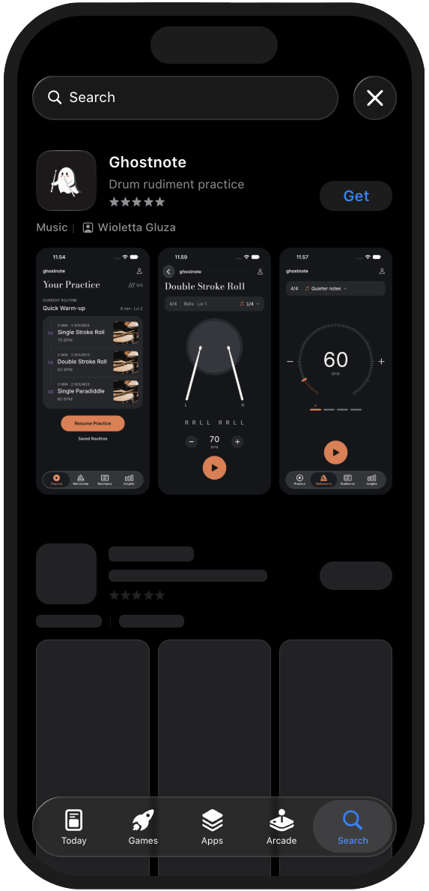
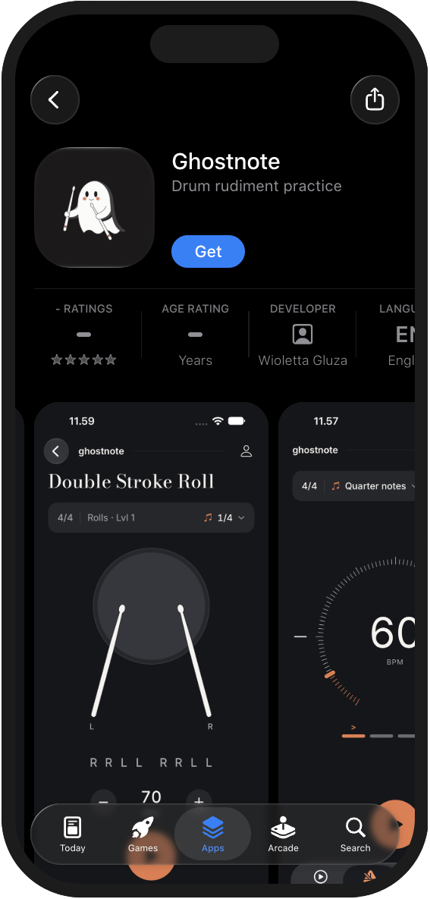

# Ghostnote

An iOS app for learning and practising drum rudiments, such as rolls and paradiddles. You pick a routine, play each rudiment against a click, and the app keeps a record of your practice.

<p>
  
  &nbsp;&nbsp;&nbsp;
  
</p>

## What it does

- **Practice** - play a routine of rudiments, round by round, with a tempo and a duration for each round.
- **Metronome** - a standalone click with time signatures, subdivisions and a tempo dial.
- **Library** - the 40 rudiments with sticking notation, grouped by category and level, with search. Kit coordination exercises are planned.
- **Insights** - time practised, the balance between techniques, and achievements.
- **Routines** - build your own from the library, or start from a recommended one.

Your practice history stays on the device. The app has no account and no server.

## Built with

- Expo SDK 58 and React Native 0.88, with React 19 and the React Compiler
- Expo Router, with the native stack and native tabs
- TypeScript
- SQLite for storage, through `expo-sqlite`
- `react-native-audio-api` for the click

The app targets iOS only and has a single dark theme.

## Principles

- **Native first.** The app uses what iOS provides before it draws its own: native navigation, SF Symbols, safe areas, Dynamic Type. A custom control exists only where iOS has no equivalent.
- **Minimal.** Each dependency has a reason. The repo holds no demo code and no unused assets.
- **Configuration over native code.** The `ios` folder is generated and git-ignored. `app.json` and config plugins set the native behaviour.
- **Accessible.** Each control has a label for VoiceOver, touch targets are at least 44 points, and text scales with the system setting.

## Run it

You need a Mac with Xcode and Node.

```bash
npm install
npm run ios
```

`npm run ios` builds the app and opens it in the iOS Simulator. After the first build, `npm start` starts the bundler on its own.

To run on a device, set your own Apple development team in Xcode. The repo does not include one.

## Scripts

| Script                    | What it does                                                |
| ------------------------- | ----------------------------------------------------------- |
| `npm start`               | Starts the Metro bundler                                    |
| `npm run ios`             | Builds the app and runs it in the iOS Simulator             |
| `npm test`                | Runs the logic tests and the component tests                |
| `npm run test:logic`      | Logic tests, with the Node test runner                      |
| `npm run test:components` | Component tests, with Jest and React Native Testing Library |
| `npm run typecheck`       | Type-checks with TypeScript                                 |
| `npm run lint`            | ESLint                                                      |
| `npm run format`          | Prettier                                                    |

## Structure

| Folder           | Holds                                                          |
| ---------------- | -------------------------------------------------------------- |
| `src/app`        | Routes only, one file per screen                               |
| `src/features`   | Screens, their components, domain logic and stores, by feature |
| `src/components` | Shared components, each with its test                          |
| `src/storage`    | Reading and writing saved data, with validation                |
| `src/theme`      | Colour, typography, spacing and layout tokens                  |
